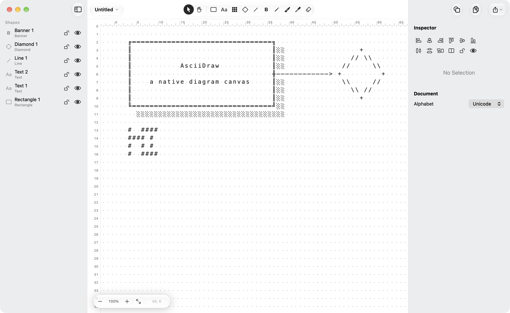
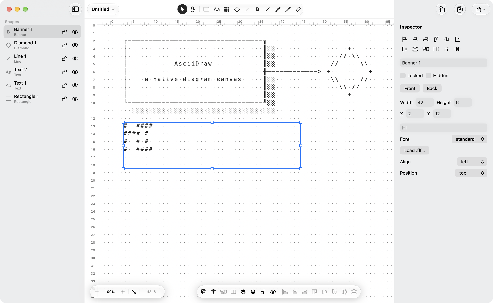
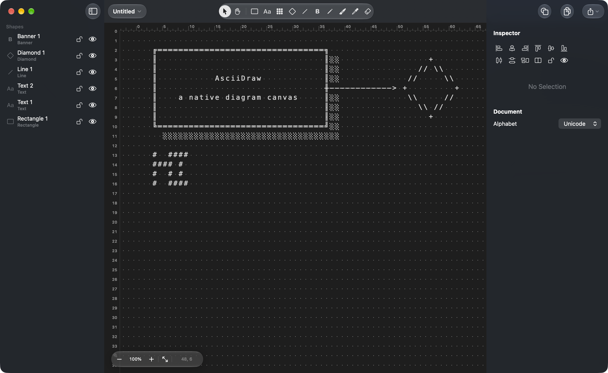

# AsciiDraw

Native macOS diagram editor for monospaced character art. Shapes live on a free character canvas and render to one grid: rectangles, diamonds, text, lines, and FIGlet banners.

[Download for macOS](https://github.com/aaqaishtyaq/asciidraw/releases/latest/download/AsciiDraw.dmg) · [Website](https://aaqaishtyaq.github.io/asciidraw/)

The download is a disk image. Drag AsciiDraw to Applications. The build is ad-hoc signed, for Apple silicon, and needs macOS 26 or later. Right-click the app and choose Open the first time. [Install notes](https://aaqaishtyaq.github.io/asciidraw/#install).







## Build

```sh
swift test
scripts/build-app.sh
open build/AsciiDraw.app
```

`scripts/build-app.sh` writes `build/AsciiDraw.app` and `build/asciidraw`. The command is also copied to `AsciiDraw.app/Contents/SharedSupport/asciidraw`, which is where the disk image keeps it. GitHub Actions runs the same script on `macos-26` and publishes `AsciiDraw.dmg` on the latest release. The site in `docs/` is GitHub Pages.

The `asciidraw` command prints a saved document or writes recoverable JSON:

```sh
asciidraw Diagram.asciidraw
asciidraw --json Diagram.asciidraw
```

Documents are JSON files with the extension `.asciidraw`.

View → Appearance follows the system, or locks the window to light or dark. The canvas, rulers, and inspector use the same appearance.

## MCP

`asciidraw-mcp` lets Claude and other MCP clients read and edit the open document. The app has to be running. The server talks to it on a local socket.

```json
{
  "mcpServers": {
    "asciidraw": {
      "command": "/absolute/path/to/AsciiDraw.app/Contents/MacOS/asciidraw-mcp"
    }
  }
}
```

After `scripts/build-app.sh`, that binary is `build/AsciiDraw.app/Contents/MacOS/asciidraw-mcp`.

Tools: `read_canvas`, `list_shapes`, `add_shape`, `set_text`, `set_frame`, `delete_shapes`, `select_shapes`, `set_zoom`.

## Tools

Keys select a tool with no modifier. Space pans and restores the previous tool.

| Key | Tool |
| --- | --- |
| V | Select |
| R | Rectangle |
| D | Diamond |
| T | Text |
| S | Surface |
| L | Line |
| P | Pencil |
| E | Eraser |
| B | Bucket |
| K | Picker |
| A | Banner |
| H | Pan |

Rectangles have single or double borders, a fill, and a shadow. Lines can be orthogonal or staircase, dashed, and finished with an arrow or one of three Crow’s foot ends. Drag a line endpoint onto a rectangle border to attach it. Option-click a border to drop a point the line can stick to.
